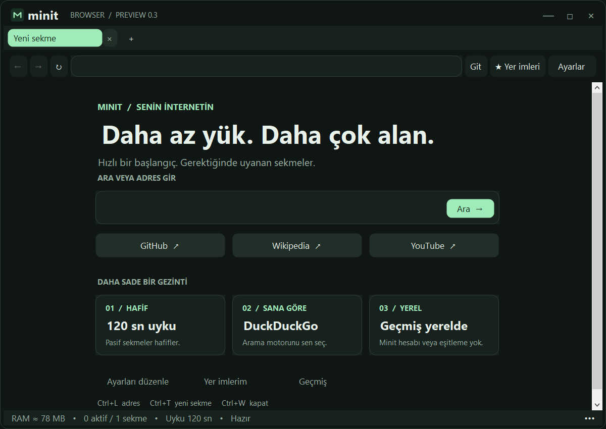

# Minit Browser

**An open-source Windows browser prototype, licensed under MIT.** Native dark/light themes, a custom window frame, translucent edges and configurable sleeping tabs — built with C# / .NET 10 WinForms and Microsoft Edge WebView2.



## Download v0.3

Choose **Minit-v0.3-Windows-x64-Setup.exe** for installation, or the **Minit-v0.3-MIT-Windows-x64.zip** portable package from [Releases](https://github.com/mustafakula10/minit-browser/releases). Extract the entire folder and run `MinitBrowser.exe`. A separate .NET installation is not required. [Microsoft Edge WebView2 Runtime](https://developer.microsoft.com/microsoft-edge/webview2/) must be installed. The app is unsigned; this is an experimental preview, not a production browser replacement.

Lower RAM usage than Chrome has **not** been benchmarked. The goal is to reduce background-tab load; the displayed working-set sum is approximate and may double-count shared memory.

## Features

- Custom rounded frame, original M logo, window drag, resize, minimize and maximize/restore.
- Translucent outer rim, separate from the opaque website content. Toggle it under **Ayarlar → Görünüm**. This is a tinted transparent edge, not an OS acrylic blur effect.
- Dark/light themes, start-page search and quick links.
- Tab close buttons, middle-click close and **Bellekte tut** (keep in memory).
- Background tabs unload after 30–3600 seconds (default 120). Active, pinned, audio-playing and downloading tabs are protected.
- DuckDuckGo, Google or Bing, default zoom, download-folder selection and session URL restoration.
- Optional local history, bookmark management and a RAM indicator.
- Turkish interface and persistent settings.

Sleeping tabs reload when selected. Unsaved forms, scroll position and per-tab navigation history are not preserved. Keep form/media tabs in memory when needed.

## Build and test

On Windows x64 with the .NET 10 SDK:

```powershell
dotnet restore MinitBrowser.csproj
dotnet build MinitBrowser.csproj -c Release
dotnet run --project MinitBrowser.csproj -c Release
```

Run built-in checks on an interactive Windows desktop with WebView2 installed:

```powershell
dotnet run --project MinitBrowser.csproj -c Release -- --self-test
```

The test uses a separate profile and writes `self-test.txt` plus preview images next to the executable. A normal user profile is not used. `--visual-test` opens a separate temporary profile for manual UI checks.

For a portable distribution, run `./build.ps1`. It creates `publish/`, copies the bundled third-party license notices, and optionally tests the published executable with `./build.ps1 -Test`.

## Validation and limits

The published v0.3 executable passed [these checks](self-test.txt): actual HTML rendering/JavaScript, configured tab expiry and protection, renderer recreation, session-address storage, borderless frame/icon, resize hit zones, rim visibility toggle, maximize/restore, settings UI save and persistence, selected search engine, zoom, disabled sleeping, corrupt-settings recovery and history deduplication. Build completed with zero warnings and errors. Home layouts and all four settings pages were visually inspected.

Actual mouse-drag interaction and desktop-compositor transparency were not independently verified by screenshot automation: the native capture helper timed out. Window geometry and visibility were checked programmatically. Downloads, permission prompts and broad external-site compatibility still need manual end-to-end testing. No comprehensive browser security audit or performance comparison has been performed.

Missing features: extensions, private mode, sync, a cookie-management panel, password-manager UI and automatic Minit updates. WebView2 certificate checks and security defaults are not disabled.

## Local data

Settings, bookmarks, optional history (up to 500 distinct URLs), session addresses and WebView2 data are stored under `%LOCALAPPDATA%\MinitBrowser`. Disabling history does not delete older records; history deletion does not clear cookies or signed-in sessions.

The first normal launch can copy preferences/bookmarks/history/session-address files from the earlier Minti prototype if matching Minit files do not exist. Old files are preserved. WebView2 cookies and signed-in sessions are not migrated.

Minit implements no user account or cloud synchronization. Websites, search engines and WebView2 have their own networking behavior; this is not an offline or telemetry-free claim.

## Status and rights

An AI-assisted learning prototype, version 0.3. Minit source code, original assets and documentation are released under the [MIT License](LICENSE). You may use, modify, fork and redistribute them, including commercially, while retaining the copyright and license notice. Contributions are welcome through issues and pull requests under the same license.

Third-party components retain their own terms. Microsoft Edge WebView2 Runtime is a separately licensed Microsoft component and is not made open source by the Minit license. Included license and notice files cover WebView2, .NET and Windows Forms.

## Türkçe

**Minit**, Windows için sekme yönetimine odaklanan bir tarayıcı prototipidir. Klasik Windows başlığı yerine özel pencere düğmeleri, logo ve yarı saydam dış kenarlar kullanır. **Ayarlar** bölümünden tema, arama motoru, uyku süresi, yakınlaştırma, indirme klasörü ve geçmiş kaydı değiştirilebilir. Eklenti/gizli mod/eşitleme yoktur; Chrome ile RAM kıyaslaması yapılmamıştır.

Minit kaynak kodu, özgün görselleri ve belgeleri MIT lisansıyla açık kaynaktır. Telif ve lisans bildirimini koruyarak kullanabilir, değiştirebilir ve ticari olarak da dağıtabilirsin. WebView2 Runtime ayrı Microsoft lisansına tabidir.


## Windows installer

Download **Minit-v0.3-Windows-x64-Setup.exe** from Releases and run it. It installs for the current Windows user under `%LOCALAPPDATA%\Programs\Minit`, creates Start menu shortcuts and offers an optional desktop shortcut. Windows Settings → Apps includes an uninstall entry. Uninstall preserves your browser profile and preferences under `%LOCALAPPDATA%\MinitBrowser`.

Requirements: Windows 10 version 2004 (build 19041) or later, x64-compatible CPU, and Microsoft Edge WebView2 Evergreen Runtime. Setup checks for WebView2 and explains how to install it from Microsoft if missing; it does not download or install it automatically. No separate .NET installation is needed. Setup and the app are unsigned previews.

To build the installer, install [Inno Setup 6.7+](https://jrsoftware.org/isdl.php), then run:

```powershell
./build-setup.ps1 -IsccPath 'C:\Program Files (x86)\Inno Setup 6\ISCC.exe'
```

The MIT-licensed installer source is `minit-setup.iss`. Outputs and SHA-256 are written to `dist/`.

**Türkçe:** Setup.exe normal kurulum yapar. Başlat menüsü kısayollarını ve kaldırma kaydını ekler; masaüstü kısayolu isteğe bağlıdır. Kaldırma sırasında kişisel tarayıcı verileri korunur. WebView2 yoksa Microsoft'un indirme adresi gösterilir.
